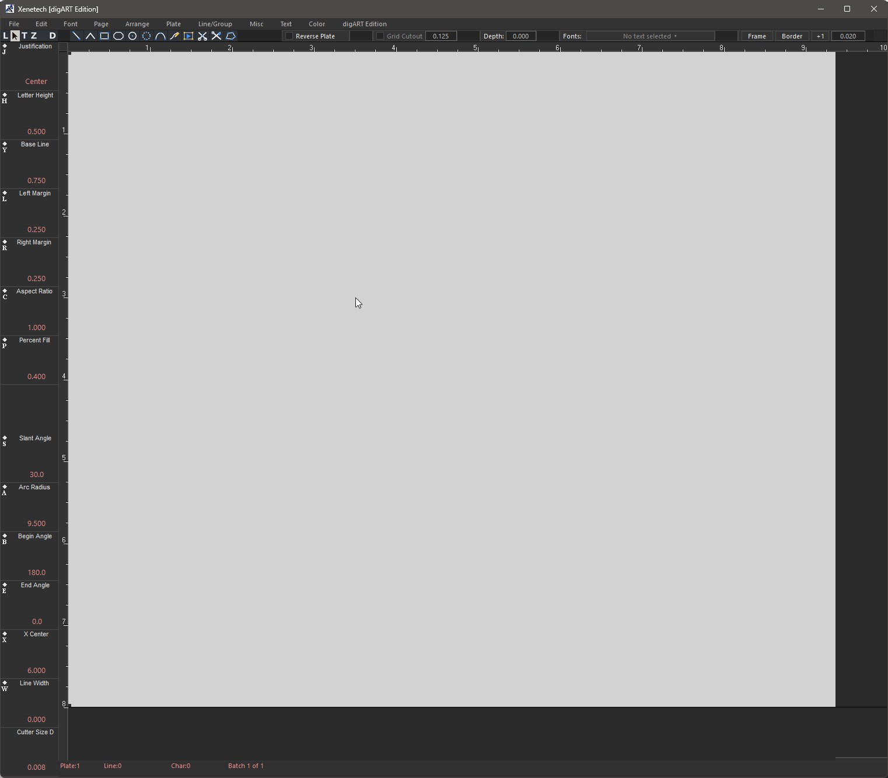
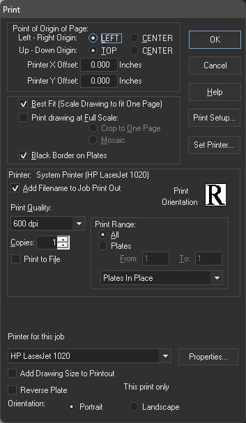
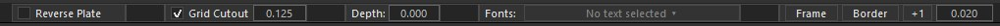
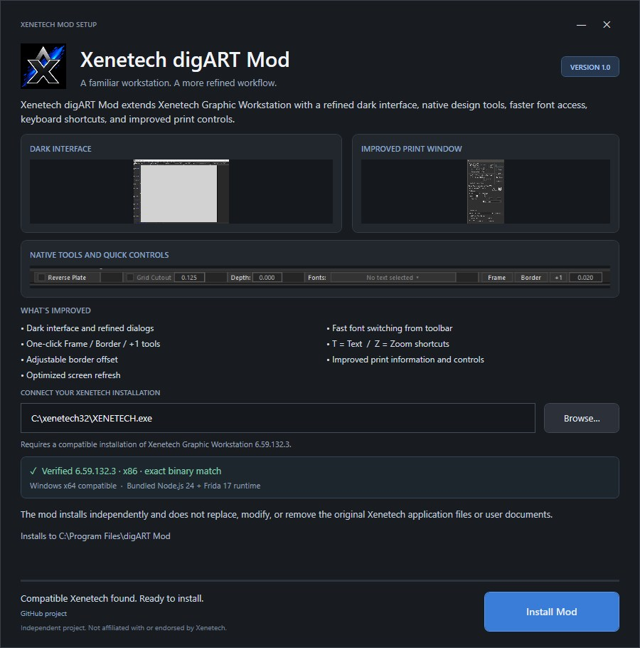

# Xenetech digART Edition Mod

**A modernized experience for Xenetech Graphic Workstation**

Dark interface · Workflow enhancements · Quick-access tools · Windows integration

**Windows 11 x64** · **Xenetech 6.59.132.3** · **v1.0**

## Overview

**Xenetech digART Edition Mod** is an independently developed modification for Xenetech Graphic Workstation. It refreshes the application’s appearance and adds practical tools to make everyday work more convenient, while retaining the familiar Xenetech workflow.

The modification runs alongside an existing Xenetech installation through its own launcher. The original application executable is not permanently patched or replaced.

## Main interface

A redesigned dark workspace with updated visual styling and refinements to the main interface.

## Features

### Printing and quick settings

The printing workflow includes additional interface controls and faster access to selected settings directly from the printer window.

### Toolbar and quick tools

Quick-access tools streamline commonly used actions. Additional enhancements cover selected native workflow controls, including Frame/Border operations.

### Keyboard shortcuts

Shortcut handling has been refined for practical editing workflows, including T/Z behavior while preserving normal text input.

### Windows integration

The mod includes a dedicated launcher, application icon, desktop and Start Menu shortcuts, and Windows taskbar integration. On the tested Windows 11 setup, pinning the application and **Shift-clicking its taskbar icon to open another modded instance** both work as expected.

### Custom installer

A dedicated branded installer supports both first-time setup and upgrading an existing digART installation, as well as uninstalling the modification separately from Xenetech.

For a fuller description, see [Features](docs/FEATURES.md).

## Technical highlights

The project combines a separate launcher, runtime interface customization, native Windows integration, and modular workflow enhancements. A particular challenge was ensuring that Windows associated the running native application window with the digART launcher rather than the original executable. That work enabled consistent taskbar icons, pinned launching, and multi-instance relaunching.

Read more in the [Technical Overview](docs/TECHNICAL-OVERVIEW.md) and [Development Story](docs/DEVELOPMENT-STORY.md).

## Compatibility

| | Tested configuration |
| --- | --- |
| Operating system | Windows 11 x64 |
| Xenetech version | Graphic Workstation executable 6.59.132.3 |
| Application | Native 32-bit Xenetech with a separate 64-bit digART launcher |
| Installation | Upgrade, fresh installation, uninstall/reinstall verified |
| Windows integration | Custom taskbar icon, pinning, Shift-click multi-instance launching verified |

The original Xenetech Graphic Workstation installation is required. Compatibility with other versions and environments has not been established. See [Compatibility and Validation](docs/COMPATIBILITY.md).

## Documentation

- [Features and Improvements](docs/FEATURES.md)
- [Technical Overview](docs/TECHNICAL-OVERVIEW.md)
- [Development Story](docs/DEVELOPMENT-STORY.md)
- [Compatibility and Validation](docs/COMPATIBILITY.md)
- [Project Status](docs/STATUS.md)

## Availability

This repository presents the project, its functionality, and engineering background. It does not currently provide an installer download or the production implementation.

## Disclaimer

Xenetech digART Edition Mod is an independent, unofficial project. It is not affiliated with, sponsored by, or endorsed by Xenetech. Xenetech Graphic Workstation and related trademarks belong to their respective owners. See the [full disclaimer](DISCLAIMER.md).
